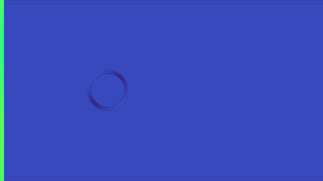
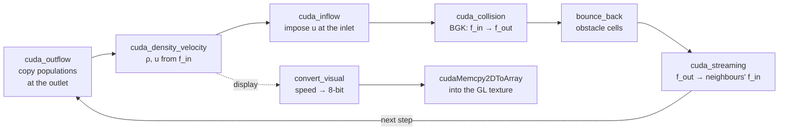
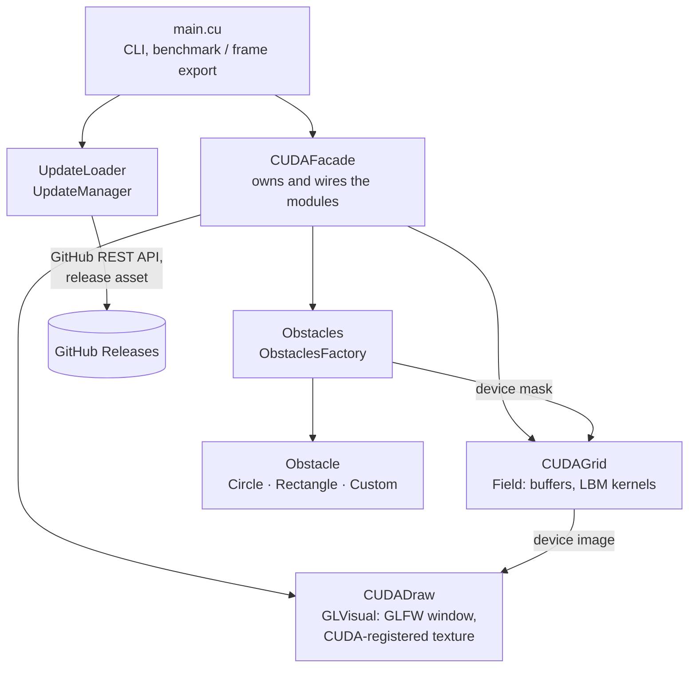

# LBMSim — 2D lattice Boltzmann fluid simulation on CUDA

[](https://github.com/buklinfur/2D-physics/actions/workflows/build.yml)
[](https://github.com/buklinfur/2D-physics/releases)
[](LICENSE)

LBMSim simulates low-Mach (nearly incompressible) 2D flow around obstacles with the lattice Boltzmann
method (D2Q9, BGK) entirely on an NVIDIA GPU and shows the velocity field live while it runs. Every simulation step runs as a
chain of CUDA kernels; the image is written straight into an OpenGL texture through CUDA–OpenGL
interop, so the field never travels back to the CPU.

<!-- TODO(demo): add docs/media/demo.gif (see "Recording the demo" below) and uncomment:
<p align="center"></p>
-->

**Status:** v0.1.0, technical preview — the core works; layout, performance and features are still being reworked.

- Live view of a 1920×1080 lattice by default, any size via `--size`
- Obstacles: circles, rectangles and arbitrary sets of solid cells, combined freely
- `--benchmark` mode with MLUPS / ms per step, headless or with rendering
- Headless frame export (`--dump-frames`) for videos
- Self-update from GitHub Releases with SHA-256 verification
- CI builds every push; tagged commits are built and published as releases

## How it works

### The method in one paragraph

The fluid is represented by particle distribution functions $f_i(\mathbf{x}, t)$ on a square
lattice, one per discrete velocity $\mathbf{e}_i$ of the **D2Q9** stencil (rest, 4 axis, 4 diagonal
directions). Each step relaxes them towards the local equilibrium (BGK collision) and moves them to
the neighbouring node (streaming):

$$
f_i(\mathbf{x} + \mathbf{e}_i,\, t+1) = f_i - \omega\,\bigl(f_i - f_i^{\mathrm{eq}}(\rho, \mathbf{u})\bigr),
\qquad
f_i^{\mathrm{eq}} = w_i\,\rho\left(1 + 3\,\mathbf{e}_i\!\cdot\!\mathbf{u} + \tfrac{9}{2}(\mathbf{e}_i\!\cdot\!\mathbf{u})^2 - \tfrac{3}{2}\,\mathbf{u}^2\right)
$$

Density and velocity are moments of $f$: $\rho = \sum_i f_i$, $\rho\mathbf{u} = \sum_i f_i\mathbf{e}_i$.
The relaxation rate comes from the Reynolds number: $\nu = u_{LB}\,r / Re$, $\omega = 1/(3\nu + 1/2)$,
with the characteristic length $r = (H-1)/9$.

Boundaries: velocity inlet on the left (Zou/He-style non-equilibrium bounce-back, with a small
sinusoidal perturbation of the inflow profile), zero-gradient outlet on the right, full-way
bounce-back on obstacle cells, periodic top and bottom.

### One step on the GPU

Each lattice node is handled by one thread (16×16 blocks by default); boundary kernels use one thread
per edge cell. Populations are stored as `float[node][9]` in two buffers, `f_in` and `f_out`.



### Modules



| Module | Path | Role |
|---|---|---|
| `CUDAFacade` | `ProjectSource/CUDAModules/CUDAFacade` | Single entry point: creates the field, the window and the obstacle factory; runs the loop, the benchmark and the frame export |
| `CUDAGrid` | `ProjectSource/CUDAModules/CUDAGrid` | `Field` class and all LBM kernels |
| `CUDADraw` | `ProjectSource/CUDAModules/CUDADraw` | `GLVisual`: GLFW/GLEW window, texture registered with `cudaGraphicsGLRegisterImage` |
| `Obstacles` | `ProjectSource/CUDAModules/Obstacles` | `Obstacle` hierarchy and `ObstaclesFactory`, which rasterises shapes into the device mask |
| `UpdateLoader` | `ProjectSource/UpdateLoader` | Release check, download, SHA-256 verification, install script |

Function-level documentation lives in the headers (Doxygen-style comments); see also
[`ProjectSource/CUDAModules/README.md`](ProjectSource/CUDAModules/README.md).

## Build

Requirements: Linux x86_64, an NVIDIA GPU with a working driver, CUDA Toolkit 12.x,
CMake ≥ 3.18, GCC.

```bash
# Ubuntu 24.04
sudo apt update
sudo apt install -y build-essential cmake git nvidia-cuda-toolkit \
    libglew-dev libglfw3-dev libcurl4-openssl-dev nlohmann-json3-dev libssl-dev

git clone https://github.com/buklinfur/2D-physics.git
cd 2D-physics
cmake -S ProjectSource -B build -DCMAKE_BUILD_TYPE=Release
cmake --build build -j
```

The GPU architecture is taken from `nvidia-smi`; override it with `-DCUDA_ARCH_LIST="86"` (or a
`;`-separated list), for example when building on a machine without a GPU.

## Run

```bash
./build/executables                      # 1920×1080, original demo scene
./build/executables --size 960x540 --re 100
./build/executables --help
```

| Option | Default | Meaning |
|---|---|---|
| `--size WxH` | `1920x1080` | Lattice size in nodes (also the window size) |
| `--re R` | `10` | Reynolds number |
| `--ulb U` | `0.04` | Inflow velocity in lattice units (keep ≲ 0.1) |
| `--block B` | `16` | CUDA block edge, B×B threads |
| `--lim L` | `0.1` | Speed shown as full white |
| `--vsync 0\|1` | `1` | Interactive mode only |
| `--no-update` | | Skip the release check at start-up |
| `--benchmark` | | Timed run, see below |
| `--dump-frames DIR` | | Headless run that writes PGM frames to `DIR` |

The scene is one circle at (W/3, H/2) with radius H·100/1080. More obstacles can be added in
`main.cu` through `CUDAFacade::add_circle`, `add_rectangle` and `add_custom`.

## Performance

```bash
./build/executables --benchmark --size 1920x1080 --steps 2000            # compute only, no window
./build/executables --benchmark --size 1920x1080 --steps 2000 --render   # + drawing, vsync off
benchmarks/run_benchmarks.sh                                              # full table, see below
```

`--benchmark` runs `--warmup` untimed steps, then `--steps` timed ones, and synchronizes the device
before reading the clock. It times the same `Field::step()` the application uses, so the numbers
describe the program as shipped, not an isolated kernel. MLUPS = million lattice-node updates per
second. A final NaN/Inf check marks unstable runs.

[`benchmarks/run_benchmarks.sh`](benchmarks/run_benchmarks.sh) builds a Release binary, records the
hardware and toolchain to `hardware.txt`, runs every grid size several times and writes medians to
`benchmarks/results/<date>-<host>/summary.md`. Under WSL2 only the compute-only and CPU columns
are measured: CUDA on WSL does not support CUDA–OpenGL interop, so the window and `--render` need
native Linux.

<!-- TODO(bench): replace with benchmarks/results/<date>-<host>/summary.md from a real run -->
**Results:** not measured yet.

| Grid | Nodes | GPU ms/step | GPU MLUPS | GPU + render, FPS | CPU prototype ms/step | Speed-up vs CPU prototype |
|---|---:|---:|---:|---:|---:|---:|
| 640×360 | 0.23 M | TODO | TODO | TODO | TODO | TODO |
| 960×540 | 0.52 M | TODO | TODO | TODO | TODO | TODO |
| 1280×720 | 0.92 M | TODO | TODO | TODO | TODO | TODO |
| 1920×1080 | 2.07 M | TODO | TODO | TODO | TODO | TODO |

**About the CPU column.** It is the project's first prototype from the `alpha-version` branch, run
unchanged through [`benchmarks/cpu_reference`](benchmarks/cpu_reference/alpha_cpu_bench.cpp):
one thread, `double`, nested `std::vector` storage. It answers "how far did the GPU rewrite take the
project", not "GPU vs. a tuned CPU solver"; an OpenMP/SIMD CPU code would narrow the gap considerably.

Known headroom in the GPU code: populations are stored per node (`[node][9]`), so warps read
strided memory; a structure-of-arrays layout, fused collide-and-stream, and dropping the
`cudaDeviceSynchronize()` after every kernel are the obvious next steps.

## Recording the demo

```bash
./build/executables --dump-frames frames --size 960x540 --re 100 --steps 6000 --every 20
tools/make_demo_gif.sh frames docs/media/demo.gif --width 800          # grayscale, as in the app
tools/make_demo_gif.sh frames docs/media/demo.mp4 --color              # or a coloured MP4
```

Frames are the same speed image the window shows, origin at the bottom. Higher `--re` gives an
unsteady wake; if the field check reports NaN, lower `--re` or `--ulb`.

## Releases and self-update

Pushing a tag `vX.Y.Z-master` (or `-release`) runs [`release.yml`](.github/workflows/release.yml):
it builds the binary for sm_60…sm_89, packs `executables`, `version.info` and the install script
into `lbm-linux-Release-<tag>.tar.gz` and `lbm-linux-latest.tar.gz`, and publishes them with
`SHA256SUMS` as a GitHub release.

On start-up (unless `--no-update`, `--benchmark` or `--dump-frames`) the app:

1. reads the latest release from `api.github.com/repos/<repo>/releases/latest`;
2. if its tag differs from the bundled `version.info`, asks whether to update;
3. downloads `lbm-linux-latest.tar.gz` and checks its SHA-256 against the digest GitHub publishes
   for the asset — no digest or a mismatch aborts the update;
4. runs `UpdateLoader/scripts/update.sh`, which unpacks into a temporary directory and replaces the
   binary and `version.info` by `rename()`;
5. `execv()`s the new binary with the same arguments.

The repository is a CMake cache variable: `-DLBMSIM_UPDATE_REPO=owner/name`.

Running a release build needs the NVIDIA driver plus the runtime libraries:
`sudo apt install libcudart12 libglew2.2 libglfw3 libopengl0 libcurl4`.

## Repository layout and history

| Branch | Content |
|---|---|
| `master` | Current code (this README) |
| `release` | Snapshot used for the v0.1.0-release tag, with an unfinished JSON config parser |
| `cuda-version` | First CUDA port |
| `alpha-version` | CPU prototype of the solver (single thread, SFML window) |
| `cmake-sfml-project` | SFML grid visualiser used by the prototype |

## Authors

- **Valeriy Zaichikov** ([@buklinfur](https://github.com/buklinfur)) — modular CMake structure and
  module split (`CUDAFacade`, obstacle factory), self-update loader, CI/CD release pipeline,
  refactoring and documentation for v0.1.0, benchmark mode and tooling.
- **Lev Moryakin** ([@ribus2005](https://github.com/ribus2005)) — SFML visualiser and CPU prototype, LBM kernels
  of the CUDA version, resizable grid and flow directions.

## License

[MIT](LICENSE) © 2025 Valeriy Zaichikov, Lev Moryakin
